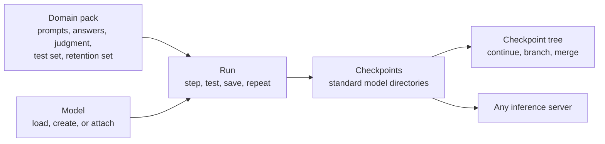

# What miForge is

**miForge makes weights.** It does three things with a language model, all through one
training loop:

| | What it means |
|---|---|
| **Creates weights** | Builds a brand-new model from an architecture description and random starting values. No existing model is needed. |
| **Changes weights** | Updates every parameter of an existing model toward a domain you care about. |
| **Adds weights** | Trains a small low-rank adapter beside an existing model, which you can keep separate or merge into the model later. |

The loop is always the same: **push the weights in a direction defined by some domain material,
test the result, save a checkpoint, repeat.** Every saved checkpoint is an ordinary model you
can load, compare, branch from or throw away.

## Who it is for

miForge is built for **one operator with one graphics card** (a 24 GB card is the reference
target). You do not need a training team, a cluster or a specialist's knowledge of optimizer
settings. You need:

- a model you want to improve (or an architecture to start from),
- some material that describes your domain, and
- a way to tell good answers from bad ones.

A **domain expert** who has material but does not run infrastructure meets miForge through
**pack authoring**: describing what good looks like, trying it on a sample, and handing the
result to the operator. See [Domain packs](guides/packs.md).

## Three promises

1. **Nothing untested is presented as a model.** Every checkpoint carries the score of the step
   that produced it, and a checkpoint is written atomically: on disk it is either absent or
   complete, never half-written.
2. **It needs nothing else running.** miForge loads or creates the model itself, trains in its
   own process and writes its own checkpoints. The other suite applications are optional
   extras, and when one is missing miForge says so by name instead of failing quietly.
3. **Its outputs are standard.** A checkpoint is a standard Hugging Face model directory, and an
   adapter is a standard Parameter-Efficient Fine-Tuning (PEFT) directory. Any inference server
   that loads those formats can serve miForge's output without knowing miForge exists.

## How the pieces fit

- A **[pack](guides/packs.md)** describes a domain once so many runs can reuse it.
- A **[run](guides/runs.md)** trains one model toward one pack until a stop condition fires.
- **[Scoring](guides/scoring.md)** measures two things at every step: whether the domain is
  improving (the *test set*) and whether general ability is being spent to get there (the
  *retention set*).
- **[Checkpoints](guides/checkpoints.md)** are the saved models, arranged in a tree you can
  branch from.
- **[Chains](guides/chains.md)** run several stages one after another, as a curriculum.

## The suite

miForge is one of four applications that work together and each run alone:

> miDataworks makes data. miLLM serves models. miStudio trains detectors and interprets
> models. **miForge makes weights.** None does another's job.

miForge runs a model **to learn**; miLLM runs one **to serve**; miStudio runs one **to
interpret**. How miForge connects to its siblings is in [Working with the suite](integrations/suite.md).

## Where to go next

- New to the vocabulary? Read [Key ideas](getting-started/concepts.md).
- Installing? Read [Installation](getting-started/installation.md).
- Ready to train? Follow [Your first run](getting-started/first-run.md).
- Connecting an AI agent? Read [The MCP server](integrations/mcp-server.md) and
  [Approvals](operators/approvals.md).
