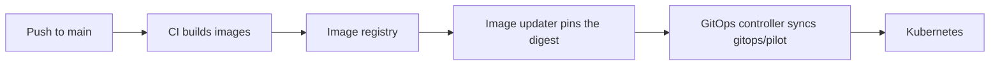

# Deployment

miForge supports two ways to run the whole application: **Docker Compose** on one machine (see
[Installation](../getting-started/installation.md)) and **Kubernetes** through GitOps, described
here.

## The GitOps path

The Kubernetes manifests live in `gitops/pilot/` as a Kustomize directory. A GitOps controller such
as Argo CD watches that directory and applies it; `gitops/pilot/argocd/` has an example
application. Container images (`hitsai/miforge-backend` and `hitsai/miforge-frontend`) are built by
continuous integration, and an image updater can pin the deployment to each new image's digest.



### What the manifests declare

| File | Contents |
|---|---|
| `namespace.yaml` | The `miforge` namespace. |
| `config.yaml` | The non-secret configuration every backend container shares (a ConfigMap). |
| `postgres.yaml`, `redis.yaml` | The database and the message broker. |
| `backend.yaml` | The backend pod: a migration step, the API, the training, generation, default and maintenance workers, and the scheduler. |
| `frontend.yaml` | The admin interface, served by nginx. |
| `mcp.yaml` | The MCP server: the backend image with its own command, no database, no volumes, and no access to a graphics card. |
| `storage.yaml` | Persistent volumes and claims for checkpoints, trainer state, run logs, parts, packs and the model cache. |
| `ingress.yaml` | Routes for the interface, the API and the MCP server. |

### Before the first sync

1. **Create the secret.** Secrets are never in the repository. Create `miforge-secrets` in the
   `miforge` namespace with `POSTGRES_PASSWORD`, plus `MCP_BEARER_TOKEN` if you run the MCP server
   and `MILLM_TRAINER_TOKEN` (and optionally `MILLM_AUDIT_LABEL`) if you use hot update:

   ```bash
   kubectl -n miforge create secret generic miforge-secrets \
     --from-literal=POSTGRES_PASSWORD="$(openssl rand -hex 24)" \
     --from-literal=MCP_BEARER_TOKEN="$(openssl rand -hex 32)"
   ```

2. **Adapt storage to your cluster.** The volumes are host-path volumes pinned to one node by its
   host name. Change the node name and paths in `storage.yaml` and the node selector in
   `postgres.yaml`. Size the checkpoint volume for your runs (the default claim is 800 GiB).
3. **Set your host names** in `ingress.yaml`.
4. **Set the optional integrations** in `config.yaml`: `MILLM_BASE_URL` and `MIDATAWORKS_BASE_URL`
   are present and empty by default, which means "not configured". Filling one in enables that
   integration; neither is required for any run type.

### The graphics card

The backend pod asks Kubernetes for no `nvidia.com/gpu` resource. Instead, every container sees
every card (`NVIDIA_VISIBLE_DEVICES=all`, with `CUDA_DEVICE_ORDER=PCI_BUS_ID`), and miForge chooses
a card for each run by its unique identifier and leases it. Pin a run to a card with its
`GPU-…` identifier in the run's GPU request; never rely on a card's index number, which can change
across restarts. `GET /api/v1/gpus` lists the cards miForge can see.

## Upgrading safely

A rollout **restarts the training worker, and a run it is executing ends**. The backend uses a
recreate strategy, so there is never a second worker competing for the card. Before you push a
change that rolls the backend:

1. check for a running run (`GET /api/v1/runs`, or the **Runs** screen);
2. wait for it to finish, or stop it so it saves a final checkpoint;
3. then roll out.

A run that was interrupted anyway can be continued from its last save; see
[Checkpoints](../guides/checkpoints.md#continuing-a-run).

## Storage and backups

The checkpoint, trainer-state, parts and packs volumes **are** the product: the database is an
index that can be rebuilt from the manifests on disk. Back those volumes up. The model cache
(`HF_HOME`) is disposable and deliberately kept outside them.

## Scaling the MCP server to zero

Scaling the MCP Deployment to zero replicas cuts off all AI-agent access and changes nothing else.
The admin interface and the API keep working.

## The public mirror

miForge's public repository, `hitsainet/miForge`, is a filtered snapshot of the source. Images are
built from it, and this manual is published from it to GitHub Pages.
